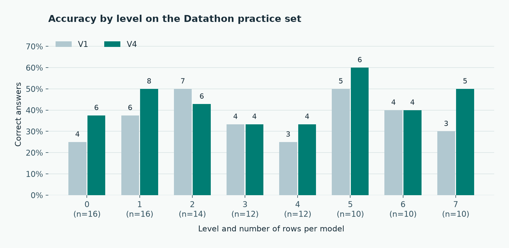

# MathQ

**An offline maths solver and bilingual tutor for the Arduino UNO Q.**

MathQ was built for the Datathon FME 2026 Qualcomm challenge. It uses a compact Qwen3.5-0.8B model on a 4 GB Arduino UNO Q. The predictor turns a problem statement into executable Python. The Pista tutor uses local model coaching, official answer keys, and related exercises to help pupils practise independently. [Challenge brief](https://github.com/mpous/datathon-UPC-maths-qualcomm-arduino-unoq)

| Component | What it does |
| --- | --- |
| **MathQ Predictor** | [`predict.py`](predict.py) outputs one letter per question under the 60-second challenge budget. The Program-of-Thought route asks the model for a short program, executes it with SmartRunner, and checks the result against the answer options. [Predictor guide](docs/predictor/README.md) |
| **Pista Tutor** | Pupils practise in Catalan or English, get progressive hints, and try related problems. The teacher view records first-try follow-up results, and the board’s LED matrix shows practice feedback. [Pista guide](docs/tutor/README.md) |

## Results

| Check | Result |
| --- | ---: |
| **Datathon organizers’ practice set** | **43/100** with V4-e1, compared with **36/100** for V1 and **20/100** for always answering `D` |
| **Text-only rows in that practice set** | **33/80** correct |
| **When V4 code matched an option** | **27/40** correct |
| **Pista bank served over HTTP** | **1,747/1,747** distinct exercises and all **3,494** expected images |
| **Pista answer-key handling** | **0 premature answer-key fields** in **7,863** checked responses |

The practice set contains 50 problems in two languages. V4 scored **22/50 in Catalan** and **21/50 in English**. It averaged **4.52 s** per row on the laptop, with an estimated **18.59 s** on the UNO Q. [Predictor evaluation and charts](docs/predictor/EVALUATION.md) · [Tutor evaluation](docs/tutor/EVALUATION.md)



## Run the project

From the repository root, run the predictor on the included synthetic sample after starting the local model service. To reproduce the V4 results, load the V4-e1 GGUF and use the documented PoT settings. [Start and reproduce the predictor](docs/predictor/RUN.md)

```bash
mkdir -p results
python3 predict.py --input data/sample_problems.jsonl --output results/predictions.csv
```

To run Pista, prepare the bilingual bank and images, then start the tutor. Open [Pista on localhost](http://127.0.0.1:8000). [Prepare the bank and deploy Pista](docs/tutor/RUN.md)

```bash
python3 tutor/server.py
```

The predictor and tutor run on the board’s Linux processor. The tutor publishes practice events to the Arduino App Lab app for display on the LED matrix. Data preparation and training run ahead of time. [Board setup](docs/setup/BOARD.md) · [Data preparation](data/README.md)

## Documentation

[Browse all documentation](docs/README.md).

| Area | Guides |
| --- | --- |
| **Predictor** | [Architecture](docs/predictor/ARCHITECTURE.md) · [Model and training](docs/predictor/MODEL.md) · [Evaluation](docs/predictor/EVALUATION.md) · [Run and reproduce](docs/predictor/RUN.md) · [Sources](docs/predictor/SOURCES.md) |
| **Pista Tutor** | [Design](docs/tutor/DESIGN.md) · [Evaluation](docs/tutor/EVALUATION.md) · [Run and deploy](docs/tutor/RUN.md) · [Live demo](docs/tutor/DEMO.md) |
| **Hardware and research** | [Board setup](docs/setup/BOARD.md) · [Datathon practice-set format](docs/benchmark/PRACTICE_SET.md) · [Experiment notes and drafts](docs/README.md#research-notes-and-drafts) |

## Repository map

| Path | Contents |
| --- | --- |
| [`predict.py`](predict.py), [`eval.py`](eval.py), [`copilot/`](copilot/) | Prediction, evaluation, prompts, and solver routes |
| [`tutor/`](tutor/), [`applab/`](applab/) | Practice server, browser interface, and LED matrix app |
| [`board/`](board/), [`laptop/`](laptop/) | Provisioning, source-data preparation, and deployment |
| [`finetune/`](finetune/), [`experiments/`](experiments/), [`analysis/`](analysis/) | Training recipe, ablations, and analysis tools |
| [`docs/`](docs/), [`results/`](results/) | Documentation and evaluation evidence |

## Credits and data

MathQ uses the M3Kang research dataset, Qwen3.5, and llama.cpp. Prepare the licensed problems and images locally using the [data guide](data/README.md). The charts and public evaluation evidence contain aggregate results. [M3Kang dataset terms](https://huggingface.co/datasets/qualcomm/M3Kang/blob/main/LICENSE.pdf) · [M3Kang paper](https://arxiv.org/abs/2601.16218) · [Qwen3.5-0.8B](https://huggingface.co/Qwen/Qwen3.5-0.8B) · [llama.cpp](https://github.com/ggml-org/llama.cpp)
