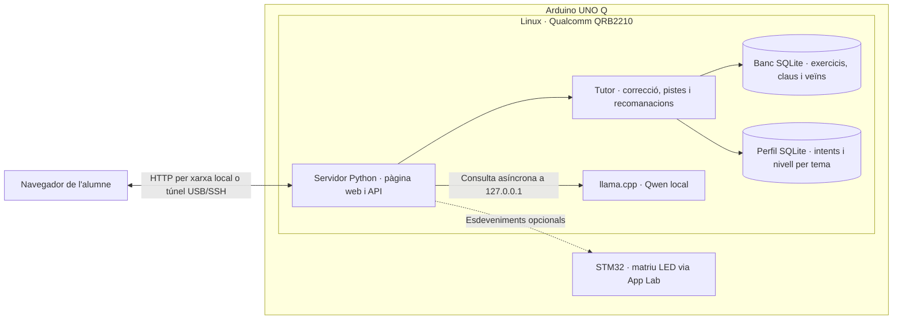

# Pista · Arquitectura i demo per al hackató

Pista ajuda l'alumne a explicar el pas següent d'un problema de matemàtiques. Proposa pistes graduades, corregeix les opcions A–E i recomana pràctica segons l'historial de cada tema.

## Arquitectura



| Component | Responsabilitat |
| --- | --- |
| **Web i API** | La placa serveix l'HTML, les fonts i els enunciats. El navegador envia respostes, demana pistes i mostra el progrés. |
| **Tutor** | Corregeix amb la clau del banc. Davant d'un error, marca l'opció i permet tornar a provar. L'escala ofereix un mètode, un exercici similar i un descart d'opcions. L'alumne pot demanar explícitament la solució. |
| **Conversa** | El Qwen local redacta una pista a partir de l'enunciat, la pregunta i el pas que l'alumne ja ha treballat. A la demo, cada exercici té indicacions verificades per orientar la generació i donar un pas concret si s'activa la reserva. Per al banc general, el model rep l'enunciat amb les xifres amagades i pot rebre informació sobre l'error. La correcció i l'escala de pistes continuen disponibles mentre el model redacta. |
| **Perfil** | Una placa per alumne. SQLite conserva els exercicis treballats, els errors, les pistes de l'escala i el progrés per tema. La demo fa servir un únic perfil fictici predefinit sense credencials. La conversa conserva l'última intenció durant l'exercici i el text del xat queda fora de l'historial d'aprenentatge. |
| **Recomanacions** | El repàs prioritza els temes amb menys encerts i més pistes. El repte busca un tema amb bon rendiment i un exercici disponible al nivell de pràctica següent. Un encert ràpid fa pujar el nivell i una dificultat repetida fa baixar-lo. |

El banc habitual utilitza els enunciats, les claus i la dificultat de M3Kang. Els exercicis similars es poden calcular abans de la sessió i copiar a la placa amb el banc. `--demo` genera un banc de vuit exercicis originals en català i anglès, així es pot provar la plataforma sense preparar M3Kang ni aixecar el servei d'embeddings.

## Arrencada

**A l'ordinador Windows**, des de la carpeta que conté `tutor/`.

```powershell
py tutor/server.py --demo --quiet
```

Obre [Pista](http://127.0.0.1:8000). Si el model local escolta al port 8081, el xat l'utilitza automàticament. Afegeix `--no-llm` per provar explícitament les regles de reserva.

**A l'Arduino UNO Q**, amb el codi copiat a la placa i des de la carpeta que conté `tutor/`.

```bash
curl -fsS http://127.0.0.1:8081/health
python3 tutor/server.py --demo --host 0.0.0.0 --quiet
```

**Al navegador de l'ordinador o del mòbil**, obre el port 8000 de l'adreça de la placa a la mateixa xarxa local. El servei `math-llm` del projecte manté el model al port 8081 de la interfície local de la placa.

Les dades de la demo es guarden a `data/tutor_demo_students.db`. Per assajar amb l'historial inicial, arrenca el servidor amb `--students data/pista-assaig.db`, amb un nom de fitxer nou per a cada assaig.

## Guió per al jurat

1. Obre la **Vista del professor**. L'Aina té **1/3** de problemes de fraccions resolts i **3/3** d'aritmètica. Clica **Repassa · Fraccions i percentatges**.
2. Demana la primera pista al problema de la pizza. El Qwen la redacta i el text apareix al xat. Tria **B (7/12)** per veure la correcció d'una opció incorrecta.
3. Escriu «Per què necessito denominadors iguals?» o «I com ho comprovo?». El xat indica **Redactada pel model local** quan el text prové del Qwen i **Pista de reserva** quan s'aplica el recurs local. L'opció **D (5/12)** permet mostrar la correcció final.
4. Torna a la vista de progrés. Mostra com ha canviat el registre i tria **Accepta el repte · Aritmètica i problemes**. Per ensenyar la persistència, torna a obrir la web després de reiniciar el servidor.

## Opcions per reforçar la presentació

| Opció | Què es pot demostrar |
| --- | --- |
| **Tria un problema M3Kang per error conceptual** | Etiqueta a mà un petit grup de distractors, com ara confondre el total menjat amb el que queda. Mostra com el mateix error activa una pregunta específica i un exercici de transferència de M3Kang. |
| **Fes visible que tot passa a la placa** | Desconnecta la sortida a internet mentre mantens la connexió local. Amb l'app `applab/math-matrix`, mostra la creu, la bombeta i el vistiplau quan l'alumne interactua amb la web. |
| **Mesura l'efecte de l'ajuda** | Prova el mateix exercici amb pista genèrica i amb pista específica. Compara el percentatge que resol després un problema similar, el nombre de pistes i el temps de resposta. Distingix la latència de correcció de la latència del xat. |

Prioritzaria la pista vinculada al distractor i la prova sense internet. El jurat pot veure en una mateixa seqüència com s'aprofita M3Kang, com guia el tutor i on es processen les dades.
