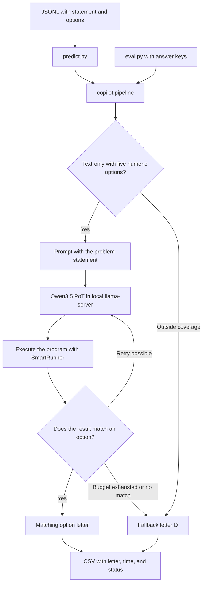

# Predictor architecture

## Evaluation contract

`predict.py` is the entry point the organizers invoke. It reads one JSON object per question and writes a CSV in input order with the columns `id,language,answer,seconds,status`. Prediction requires `id` and `text`. `options` contains the `A`–`E` alternatives, `language` identifies the translation, and `text_only` indicates whether solving the problem requires a figure. `eval.py` uses `label` to score the run. The prediction routes derive their answers from the statement and options.

Inference and Python execution run under Debian Linux on the **Qualcomm QRB2210** in the 4 GB Arduino UNO Q. `llama-server` listens at `127.0.0.1:8081`, and a Python standard-library client calls it over HTTP. The predictor runs entirely on the Linux side of the board. [Arduino UNO Q specifications](https://docs.arduino.cc/hardware/uno-q/) · [Repository map](SOURCES.md)



## Preparing options before evaluation

M3Kang’s original format stores the text statement and an image of the full problem. The five options usually appear in the image. `laptop/prepare_m3kang.py` runs RapidOCR, puts the fragments in reading order, and identifies the `A`–`E` markers. Local review can correct incomplete options and misread characters. The resulting JSONL includes the text options the predictor uses to check its answer.

Translations share a problem `id`. When expanding M3Kang to other languages, preprocessing reuses options if the Catalan and English sources agree after whitespace normalization. It records disagreements and keeps uncertain options from propagating. The expanded snapshot contains 40,617 rows from 1,747 problems in 108 languages. The split by `id` assigns 1,466 problems to `train` and 281 to `val`, keeping each problem and its translations together. [Preprocessing sources](SOURCES.md#data-and-protocol)

## Solving a row with Program-of-Thought

1. **Routing.** `copilot.pipeline.solve()` takes the `pot` route for text-only rows with five options that can be parsed as numbers. The parser handles integers, decimals, simple fractions, and some OCR errors, such as an `O` in place of zero. Rows that require a figure or have nonnumeric options get `D` with the `prior` status.
2. **Prompt.** With `POT_STYLE=finetuned`, the model receives a short system message and the problem statement. The options are held for the later check. The model can generate arithmetic, bounded enumeration, or constraint checks from the text.
3. **Generation.** The first attempt uses temperature `0` and seed `42`. The client requests up to `140` tokens per attempt. If there is no accepted match and at least `22 s` remain, it can make two more attempts with temperature `0.45`, `top_p=0.9`, and seeds `43` and `44`. Requests enable `cache_prompt`.
4. **Execution.** `copilot.llm` extracts the code, removes import lines, and passes it to SmartRunner. The program runs in a child Python process with a `2 s` timeout in the inference route.
5. **Mapping to a letter.** The matcher prefers a unique numeric match within `10⁻⁶`. It can accept a unique approximate match within `10⁻²` when there is no exact match. It also handles textual output and questions that ask for the last digit. When two outputs are captured, it checks the last and then the first. An accepted match returns `pot_match`. If the available attempts finish without an accepted option, the predictor emits `D` with `pot_fallback`.

A confirmation rule handles a recurring false positive during retries. If the first program prints `0` or produces no output, and a retry prints `1` as its candidate answer, another retry must confirm the same letter. The retry threshold uses wall-clock time, so the actual number of attempts depends on hardware and load. [PoT implementation](SOURCES.md#code-and-deployment)

### Worked example

**Problem statement.** Between 1 and 30, how many multiples of 4 are not multiples of 6?

```python
print(sum(1 for n in range(4, 31, 4) if n % 6 != 0))
```

With `A=3`, `B=4`, `C=5`, `D=6`, and `E=7`, the program prints `5` and the matcher returns `C`. The model identifies the interval and divisibility conditions. The deterministic part enumerates the values and identifies the letter.

## What SmartRunner contributes

The runner checks the Python AST, limits the names and primitives available to the generated program, blocks imports in the program, and runs it with `python -I -X utf8`. It captures standard output and attempts to limit process memory on supported platforms. Built-in access to `math`, `itertools`, `Fraction`, and combinatorial functions saves the model from generating those utilities token by token.

The compatibility layer handles recurring generation mistakes. It can treat digit tuples as numbers in numeric contexts, convert digits to strings for membership checks, and distinguish arithmetic products from Cartesian products based on the call. It keeps the first and last output when they differ and can capture a trailing expression without a `print`. These heuristics can also accept a plausible result that matches a distractor. A `pot_match` records agreement with an option, and evaluation uses the external answer key to measure how often that agreement is correct.

The separate process and AST checks constrain execution in this controlled setting. Their security guarantees are limited. [Implementation and SmartRunner ablations](SOURCES.md#design-decisions-and-experiments)

## Time budget, diagnostics, and solver modes

`TIME_LIMIT_SECONDS=60` is the challenge limit. `pipeline.py` reserves three seconds before passing the remaining time to the solver. Connection errors, timeouts, and unparseable responses get distinct statuses and the fallback letter. `predict.py` writes the CSV incrementally. `eval.py` adds the answer key, token counts, latency, model output, and a manifest that tracks progress.

| Mode | Role in the project |
| --- | --- |
| `pot` | Used for the V4 results. Short code, option matching, and a fixed fallback. It works with one model server and `--rag 0`. |
| `text` | Hybrid route for M3Kang. Uses arithmetic rules, conservative lexical matches, and a linear option ranker. The `uncertain` policy calls the model when the ranker’s highest probability is below `0.29`. It can reuse a translation in the input batch when the option sets match, then map the selected value back to the local letter. |
| `budget` | Earlier route with streamed text generation, a wall-clock limit, and an option-based fallback where applicable. |
| `direct` | A single text request with a letter response format. The code also has an experimental image route using `mmproj`. |

Retrieval-augmented generation is an experimental route. `build_index.py` indexes training problems using bge-small-en-v1.5 and SQLite. `--rag K` retrieves examples for routes that include them in the prompt. Each added example increases prefill cost. The Datathon practice set has a uniform distribution of correct letters and a different numeric option order from M3Kang. The tested PoT configuration computes from the statement and uses the options for the final check. [Comparison of datasets and solver routes](EVALUATION.md)

The hybrid route explores a different trade-off. Rules evaluate recognizable expressions and require a single matching option. The ranker weights signals such as position, numeric rank, distance from other options, answer length, and overlap with the statement. When five numeric alternatives appear out of order, the median policy provides a value-based baseline. In the practice set, 46 of the 47 English rows with five numeric options are sorted in increasing order. Position and numeric rank therefore carry almost the same information. [Experiments with text-based routes](SOURCES.md#design-decisions-and-experiments)
