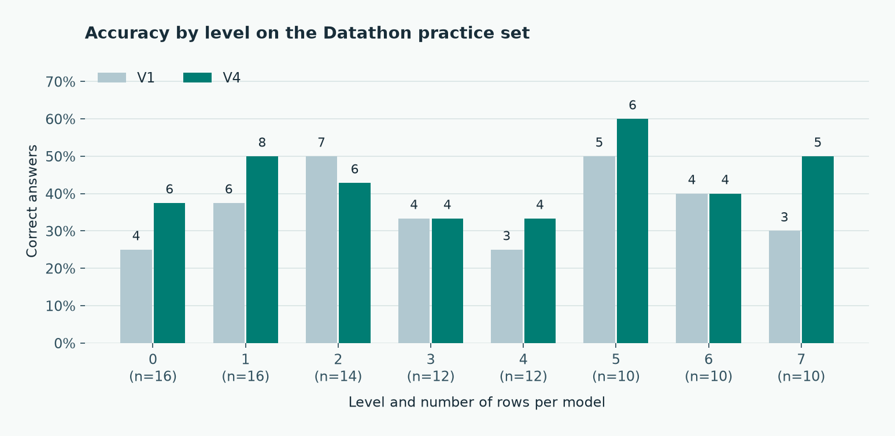
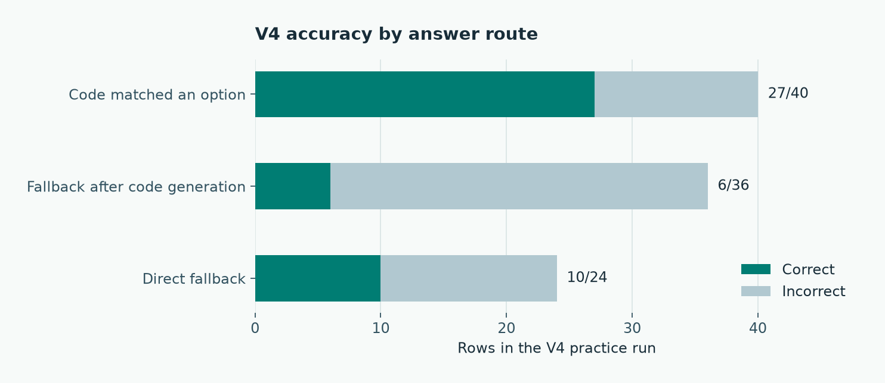
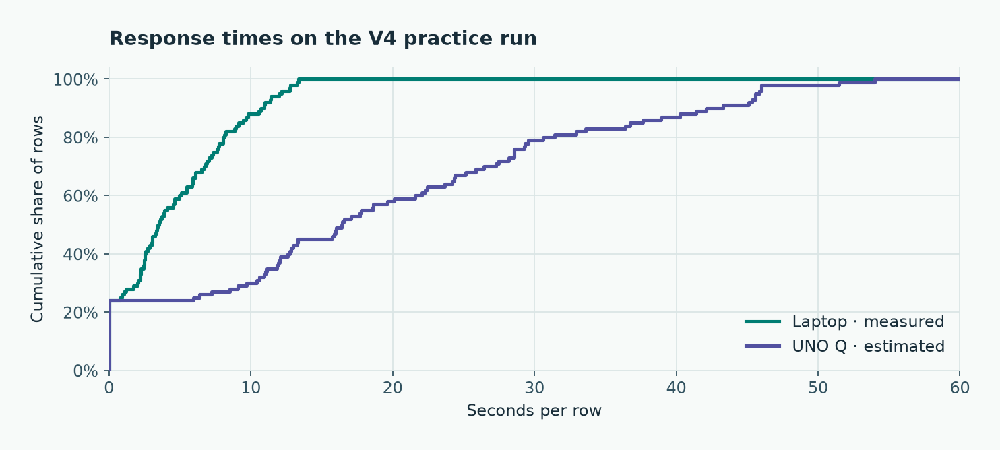

# Predictor evaluation

## Datathon FME 2026 practice set

V4-e1 answered **43/100** rows correctly on the organizers’ practice set. That is **23 percentage points** above always answering `D` and **7 points** above the recorded V1 run on the same rows. The gain over `D` comes from executing code and matching its output to an option. V4 got 27 of the 40 rows on that route right. `D` would have scored 4 on those same rows. [Practice run manifests](SOURCES.md#runs-and-evidence)

The practice set contains **50 distinct problems in two languages**, with 80 text-only rows and 20 that require a figure. Correct letters are balanced, and levels range from 0 to 7. Of the available sets, it is closest to the announced final test format. The final uses 20 new problems, one language per problem, four problems with a figure, and an offline invocation of `predict.py` with a 60-second limit per problem. [Organizers’ dataset specification](SOURCES.md#data-and-protocol)

### How the solver evolved

| Configuration | Correct | Evidence |
| --- | ---: | --- |
| Always `D` | 20/100 | Calculated from the labels for the same rows. |
| Hybrid text and ranker | 21/100 | Saved run on the same 100 rows. |
| Base Qwen with PoT and four bilingual examples | 33/100 | Historical test recorded in the technical notes. |
| PoT V1 with conditional retries | 36/100 | Saved run on the same 100 rows. |
| PoT V2 and SmartRunner, one attempt | 41/100 | Historical test recorded in the technical notes. |
| PoT V2 and SmartRunner, up to three attempts | 42/100 | Historical test recorded in the technical notes. |
| **PoT V4-e1 and SmartRunner, up to three attempts** | **43/100** | Saved run verified against the row-level labels. |
| PoT V4-e1 and SmartRunner, second run with other OCR options | 41/100 | Saved run on the same 100 rows; see below. |

The table compares complete configurations. Weights, prompts, and execution changed over the course of the project. The difference between **42 and 43** is one row, and the underlying records differ in detail. The team also used the practice set to identify code patterns that the runner could handle better. The scores describe development on this set. [Training notes and historical ablations](SOURCES.md#design-decisions-and-experiments)

**Why V4 appears as both 43/100 and 41/100.** Two saved runs of the same V4-e1 model on the same 100 rows, with the same labels, give these two scores. The practice set has no option field: the options are inside the problem image, and each run used its own OCR of them. The solver asks the model only when a row is text-only and has five numeric options; otherwise it answers `D` without the model. The 43/100 run had usable options for 76 rows and the 41/100 run for 68. On the 68 rows that both runs sent to the model, the scores are **30 and 31**: the model performs the same. The gap comes from 8 rows that the second run answered with `D` without asking the model; the first run asked the model on them and got 3 right. About half of the shared rows also got different code, from a different machine and `llama.cpp` build, which evened out. The score on the final test will depend on how the options arrive in the organizers' JSONL.

| Run | Input | Code | Rows sent to the model | Correct |
| --- | --- | --- | ---: | ---: |
| `eval-20261115-105958-184892-pot-v4-e1-smart-runner-demo` | `data/datathon-demo-eval/train.jsonl` | `b5dd54d` | 76 | **43/100** |
| `eval-20261115-110654-819345-demo-pot-v4` | `data/demo/train.jsonl` | `dc78547` | 68 | 41/100 |

The historical V2 comparison with SmartRunner shows the cost of retries. The single-attempt run got 41 answers right with an estimated mean of 11 s. Allowing up to three attempts raised the score to 42 with an estimated mean of 18.6 s. The wall-clock retry threshold lets the same code adjust the amount of work to actual latency. [Retry ablations](SOURCES.md#design-decisions-and-experiments)

### By level

| Level | Rows | Always `D` | V1 | V4 |
| ---: | ---: | ---: | ---: | ---: |
| 0 | 16 | 0/16 | 4/16 | **6/16 · 37.5%** |
| 1 | 16 | 2/16 | 6/16 | **8/16 · 50.0%** |
| 2 | 14 | 4/14 | 7/14 | 6/14 · 42.9% |
| 3 | 12 | 4/12 | 4/12 | 4/12 · 33.3% |
| 4 | 12 | 4/12 | 3/12 | 4/12 · 33.3% |
| 5 | 10 | 4/10 | 5/10 | **6/10 · 60.0%** |
| 6 | 10 | 2/10 | 4/10 | 4/10 · 40.0% |
| 7 | 10 | 0/10 | 3/10 | **5/10 · 50.0%** |

Each level contains five to eight distinct problems. Levels 5 and 7 show the numeric route also gets answers right at higher grade levels. The samples are too small to rank how difficult the levels are for the model.

### By language and input type

| Subset of the practice set | V4 | Always `D` |
| --- | ---: | ---: |
| Catalan | 22/50 · 44.0% | 10/50 · 20.0% |
| English | 21/50 · 42.0% | 10/50 · 20.0% |
| Text-only | **33/80 · 41.3%** | 10/80 · 12.5% |
| Requires a figure | 10/20 · 50.0% | 10/20 · 50.0% |

The 20 rows that require a figure use the fixed fallback `D`. The 10 correct answers in that subset reflect the answer-key distribution. The text-only score measures the PoT contribution more directly.

For distinct problems, V4 answered **18/50 correctly in both languages** and **7/50 correctly in one language**. It picked the same letter across translations in 40 of 50 pairs. In the paired V4–V1 comparison, 11 rows became correct and four became incorrect. A descriptive bootstrap by `id`, resampling both translations together 10,000 times with seed 42, gives a 95% interval of **30–56%** for V4 and **0 to 15 percentage points** for the difference from V1. These intervals describe variability under resampling of the practice set. [Aggregated evidence and calculations](assets/evidence.json)

### By answer route

| Status | Meaning | Rows | Correct |
| --- | --- | ---: | ---: |
| `pot_match` | A program’s output identifies an option | 40 | **27/40 · 67.5%** |
| `pot_fallback` | The model generates code and the predictor falls back | 36 | 6/36 · 16.7% |
| `prior` | Direct fallback for a figure or options outside coverage | 24 | 10/24 · 41.7% |

The model generated code for **76 rows**. Of these, **40/76** produced an accepted option. Accuracy was **67.5%** among those accepted matches and **43.0%** overall. V4 predicted `A/B/C/D/E` on **7/13/5/63/12** rows, respectively. The fallback accounts for **60 of the 63** predictions of `D`.

### By problem type

The practice set has no topic labels. This exploratory view applies the project’s taxonomy to the English statement and uses that topic for both translations. The classifier requires a minimum score of 4 and a minimum margin of 2. Cases below either threshold remain unclassified. The sample is small, so the breakdown is descriptive. [Classification method](SOURCES.md#data-and-protocol)

| Assigned topic | Distinct problems | V4 on bilingual rows |
| --- | ---: | ---: |
| Number properties | 9 | 11/18 |
| Counting and probability | 5 | 3/10 |
| Patterns and sequences | 2 | 4/4 |
| Algebra | 2 | 0/4 |
| Geometry and measurement | 1 | 2/2 |
| Spatial geometry | 1 | 0/2 |
| Logic | 1 | 0/2 |
| Time, money, and measurement | 1 | 1/2 |
| Unclassified | 28 | 22/56 |

### Timing and budget

| Time per row, 100 rows | Mean | Median | P95 | Max | Over 60 s |
| --- | ---: | ---: | ---: | ---: | ---: |
| Laptop, CPU and one slot · measured | 4.52 s | 3.48 s | 12.0 s | 13.37 s | 0 |
| UNO Q · estimated from tokens | 18.59 s | 16.44 s | 45.6 s | 54.00 s | 0 |

The estimate uses `input_tokens / 11 + output_tokens / 5.6`. V4 reported 4,141 input tokens and 8,302 output tokens. In PoT, the input counter covers the first request, while the output counter sums all attempts. The estimate includes fallback rows with zero tokens and approximates model cost. Actual board times depend on retries, cache state, and Python execution. [Runtime and measurement setup](RUN.md)

## M3Kang cross-check

The historical M3Kang benchmark has a different distribution from the practice set. The **V4 PoT** run included all available `text_only` rows in `cat` and `eng`, including rows without five numeric options. The dataset separates `val` and `train` by problem `id`. [Data and Vulkan runs](SOURCES.md#runs-and-evidence)

| Split | V4 | Always `D` | Catalan | English |
| --- | ---: | ---: | ---: | ---: |
| `val`, complete | **61/246 · 24.8%** | 48/246 · 19.5% | 31/123 | 30/123 |
| `train`, stopped after 527 of 1,376 rows | 184/527 · 34.9% | 131/527 · 24.9% | 86/260 | 98/267 |

`val` is the validation result. `train` is a partial diagnostic on the training split. All 527 completed rows were saved when the run stopped. In `val`, 163 of 246 rows ran inference. Of these, 42 produced a matching option and 23 of those matches were correct. Estimated UNO Q P95 was 54.8 s, with eight rows estimated above 60 s. This is the token cost of the attempts made on the laptop. The retry policy can behave differently under the actual wall-clock budget on the board. The aggregate evidence has breakdowns by level, language, status, and timing for both splits. [Aggregated evidence](assets/evidence.json)

### What the hybrid route contributed on its own cohort

In an earlier test of **121 English text-only rows with options**, the hybrid route got **44/121 (36.4%)** correct with 41 model calls. The base model alone got **37/121 (30.6%)** with 121 calls, and the ranker alone got **40/121 (33.1%)**. On a multilingual M3Kang cohort with options, `text` with translation reuse got **1,176/2,961 (39.7%)**. These results apply to the M3Kang-tuned route and cohorts with complete options. The practice and V4 scores use their respective filters. [Text experiment sources](SOURCES.md#runs-and-evidence)
