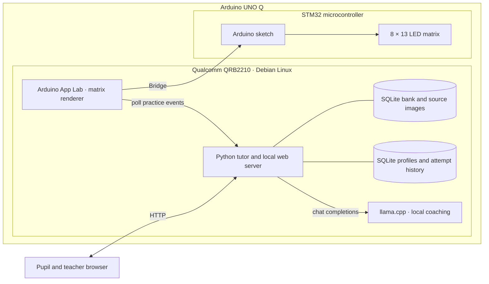

# Design and architecture

## The pupil's session

Pupils enter a profile name, choose Catalan or English, and pick a starting level from 0 to 7 and either a topic or mixed practice. The exercise is displayed as its original image, which they can enlarge. Five controls let them choose A–E. Keyboard shortcuts cover answers (A–E), hints (H), advancing from a completed exercise (N) and closing the image viewer (Escape).

The language switch changes the interface, image and coaching language while keeping the active exercise and its attempt history. Accepted hint and wrong-choice texts are stored per language. A hint rung used in either language still counts towards the same attempt. Returning pupils can continue with the same named profile and topic history.

| Pupil action | Pista's response |
| --- | --- |
| Request a first hint | **Orient.** Suggest a concrete action such as drawing, marking or organising the given information. |
| Request another hint | **Apply.** Build on the earlier direction and identify a relationship the pupil can use. |
| Request the last hint | **Check.** Suggest a way to test the method while leaving the calculation to the pupil. |
| Choose a wrong option | Mark it immediately and disable that option. While the exercise remains open, request coaching on how to test that choice against a condition in the exercise. |
| Ask a question in chat | Address the pupil's specific question in the context of the current exercise and recent help. The chat labels its replies as written by the local model. |
| Solve or confirm answer reveal | Show the official letter. An explicit reveal counts as unsolved. Three distinct wrong guesses close the exercise with two options remaining and the key still withheld until a reveal. |

The official key is held server-side. Open-attempt responses carry the exercise image, topic, level, tries and available help. The graded state includes the key on a solve or an explicit reveal. A second click confirms answer reveal so pupils have a chance to continue independently.

## M3Kang as a map of practice

An exercise ID ties English and Catalan together. The builder requires matching bilingual ID sets and validates that both versions agree on the official A–E key. Pista uses the original images for display and localised statement text for coaching. OCR option values, where available, add context for wrong-choice feedback and help the reply checker recognise the known answer. The image and official letter are sufficient for practice and grading. [M3Kang data format](https://huggingface.co/datasets/qualcomm/M3Kang#data-format)

The build combines 1,466 supplied topic assignments with a weighted keyword classifier for the remaining exercises. It vectorises the English text once to give both languages a shared similarity map. A model-free build uses normalised TF–IDF vectors. A local BGE embedding service is an alternative when preparing the bank. The builder ranks up to three neighbours in each of the easier, same-level and harder bands, prioritising the same topic, and identifies duplicate candidates. The lexical build marks identical normalised English text. The embedding build can also mark high cosine similarity. These operations happen during bank preparation, so the tutor can load the results and select exercises without a model call.

## How practice adapts

| Attempt outcome | Next level for the topic |
| --- | --- |
| First-try solve with zero or one unit of help | One level above the served exercise, capped at 7 |
| Solve after one wrong choice, or first-try solve with two or more units of help | Stay at the served level |
| Three wrong choices, a reveal, an evidenced skip, or a solve after two wrong choices | One level below the served exercise, floored at 0 |
| Skip before using any help or making any wrong choice | Keep the existing level and leave the attempt out of the topic totals |

Each distinct hint rung counts once. If chat returns help, it contributes one additional unit for the attempt. Wrong-choice feedback follows a recorded error. Mastery rises on a first-try solve with zero help and may step back after a setback at or below that level. In mixed practice Pista aims for four exercises on a topic before rotating towards a less-practised topic. It prefers unseen exercises at or near the current level and can draw from another topic when local choices run short.

### From supported work to independent practice

After an attempt with help or a wrong answer, or an exercise that ends in failure or reveal, Pista looks for an unused related exercise from the precomputed map. It checks the topic and whether the problem uses a figure, and excludes candidates marked as duplicates. Downward outcomes prefer an easier neighbour and then a same-level one. Other eligible outcomes use a same-level candidate. If there is no suitable follow-up, normal adaptive selection continues.

A first-try solve with zero help on the follow-up counts as **independent**. A solve with a wrong try or help counts as **supported**. A failed or revealed follow-up contributes to the attempted total when it has a scored outcome. This gives the teacher an immediate observation of whether a pupil can apply the idea to a related problem. The quality of that match depends on the bank's topic and similarity signals.

### Teacher view

The teacher can select a local profile and see attempted and solved totals, accuracy, help used and best streak. The topic table shows current level, mastery, accuracy and help by topic. Recent history records the outcome, wrong tries, hints and time spent. When enough attempts and eligible problems exist, Pista offers review and challenge actions that start practice in the recommended topic. The follow-up counter shows independent solves out of scored follow-up attempts.

## Coaching on the board

The reference setup uses a compact **Qwen 0.8B** instruction model in a quantised GGUF file served by **llama.cpp**. The tutor accepts a different compatible local chat-completions endpoint through `--llm`. Grading, adaptive selection and the teacher view use the same rules for every configured model. [Qwen model card](https://huggingface.co/Qwen/Qwen3.5-0.8B) · [llama.cpp](https://github.com/ggml-org/llama.cpp)

1. The tutor builds a language-specific prompt from the statement, requested type of help, recent hints, latest wrong choice when present, and the pupil's question when applicable. The official answer label stays out of the prompt.
2. The default text endpoint receives a reminder that it cannot see a diagram. An optional local vision endpoint can receive the original exercise image on diagram items. In either configuration the pupil sees the original image.
3. A worker generates a short reply while the browser polls for completion. The gateway processes one generation job at a time and keeps grading and navigation responsive. Accepted hints and wrong-choice feedback can be reused within the same attempt and language.
4. The gateway screens drafts for explicit answer phrasing, copied material, unsupported numerals and, when OCR supplied the correct option text, matches against its value or wording. Text generation can retry once, using a constrained grammar for hints and wrong-choice feedback. A rejected or failed generation leaves the hint rung available.
5. Before returning accepted coaching, the server checks that the same attempt, language and tried options are still current. This prevents a late reply from being saved against a different exercise. The checks are heuristic. Coaching can still be repetitive, weak or mathematically mistaken.

## One board, two processors

The tutor uses the Python standard library and a plain HTML, CSS and JavaScript interface with local assets. The bank is read into memory at startup. A separate SQLite file holds names, attempts, topic statistics, accepted hint and feedback text, and whether chat help was used. The browser displays the free-form conversation for the active exercise.

The tutor exposes the latest practice event at `/api/matrix`. The browser mirrors the event feed, and App Lab renders it as dots, a tick, a cross, a bulb or a level staircase. The sketch draws the frame received via Arduino Bridge. The feed is shared across the instance and holds one event at a time. A later event can supersede a brief animation before a display polls it. [Arduino UNO Q architecture](https://docs.arduino.cc/hardware/uno-q/)
